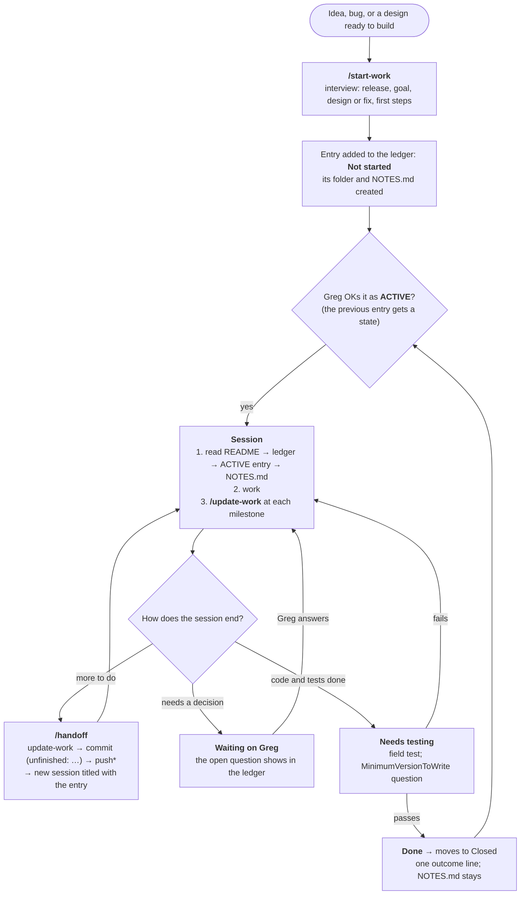
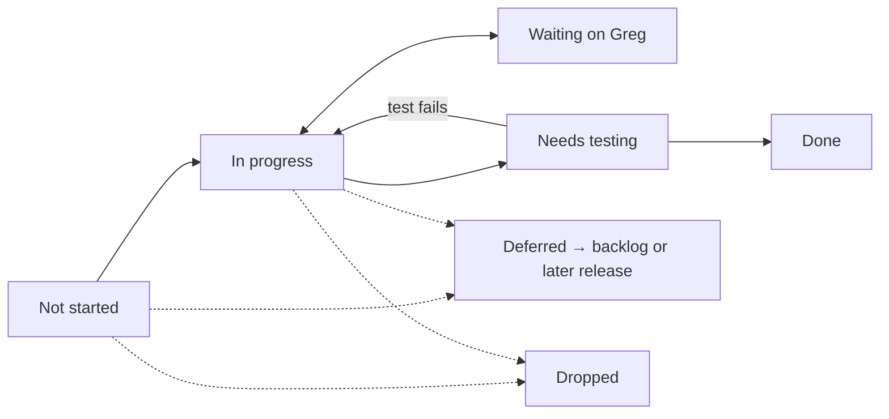
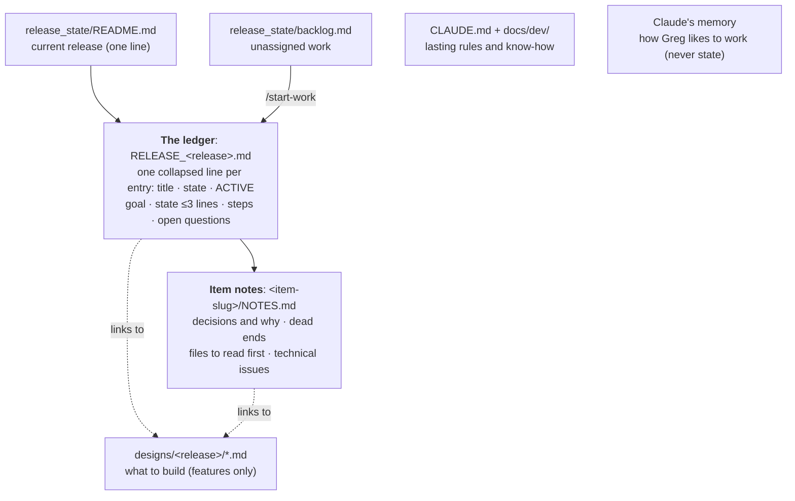

# The Release Ledger development pattern (quick reference)

All work in progress is tracked in this folder, not in session history or Claude's memory. Each release has a
**ledger** (`<release>/RELEASE_<release>.md`): one collapsed entry per piece of work, showing title · state · ACTIVE.
Open an entry for its goal, state, steps and open questions; follow its link to the **item notes**
(`<item-slug>/NOTES.md`) for decisions, dead ends, files to read first and technical issues.

**Rule of the levels:** each level only summarises the one below and links to it. Detail never moves up.

**Skills:** `/start-work` adds an entry · `/update-work` brings the ACTIVE entry up to date · `/handoff` updates,
commits, pushes and starts a fresh session. The full rules Claude follows are in CLAUDE.md, "Release Ledger".

## 1. The work loop

\* Pull before every skill. Off master, push after; on master the skill doesn't push or ask (a push redeploys the WASM demo) but reminds Greg of unpushed commits.

## 2. The states

Exactly one entry is **ACTIVE** at a time; it changes only with Greg's OK.

## 3. The map: where things live

Viewing: GitHub renders these diagrams; VS Code needs the "Markdown Preview Mermaid Support" extension.
